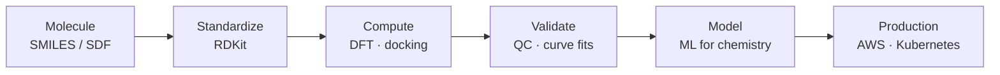

# ⚗️ Edwin Bermudez


**Computational Chemist · Cheminformatics Specialist & Senior Software Engineer**


I'm a chemist who builds the software chemistry runs on. My work centers on molecules and lab data: compound registration and structure search, assay analysis, virtual screening, quantum-chemistry calculations and ML models for chemical properties. 15+ years as a full-stack, DevOps and senior software engineer is what lets that science run reliably for pharma and biotech R&D.


```yaml
field:      Chemistry (PhD)
role:       Computational Chemist · Cheminformatics Specialist & Senior Software Engineer
chemistry:  [DFT, conformers, NMR shift prediction, structure search, docking, assay QC]
software:   [Python, Go, TypeScript, AWS, Kubernetes, CI/CD, MLOps]
experience: 15+ years in software engineering
```


## 🧬 From molecule to production





Every tool I build follows that path: represent the molecule correctly, compute on it, check the result against the science, then make it run reliably for the scientists who depend on it.


## 🧪 Projects


<details open>
<summary><b>MolVault</b> · compound registration and structure search</summary>


- Standardizes incoming structures with RDKit (salt stripping, tautomer and charge normalization) and detects duplicates by InChIKey
- Substructure and Tanimoto similarity search through the RDKit PostgreSQL cartridge
- Batch SDF registration with a review queue for ambiguous stereochemistry


`RDKit` `PostgreSQL` `FastAPI` `TypeScript` `React`
</details>


<details>
<summary><b>QM Queue</b> · quantum-chemistry job orchestration</summary>


- Generates DFT inputs from SMILES or XYZ plus a method/basis spec, with RDKit conformers
- Submits to Slurm or Kubernetes and resubmits jobs that fail to converge
- Stores parsed energies, geometries and frequencies next to the exact inputs and code versions


`RDKit` `ASE` `Python` `Slurm` `PostgreSQL` `Kubernetes`
</details>


<details>
<summary><b>Shiftcast</b> · ML prediction of NMR chemical shifts</summary>


- Graph neural network over RDKit molecular graphs, with 3D conformer input
- Per-atom uncertainty from an ensemble; atoms outside the training domain are flagged, not guessed
- Predicted vs. measured spectra side by side to help spot misassignments


`RDKit` `PyTorch Geometric` `PyTorch` `FastAPI` `React`
</details>


<details>
<summary><b>DockBatch</b> · containerized virtual screening</summary>


- Shards large ligand libraries into indexed Kubernetes Jobs on spot capacity, retrying on preemption
- Pre-built AutoDock Vina and RDKit containers for ligand preparation and scoring
- One YAML file per screening run, with a top-hits report at the end


`AutoDock Vina` `RDKit` `Go` `Kubernetes` `Karpenter` `AWS`
</details>


<details>
<summary><b>AssayFlow</b> · lab assay ingestion and automated QC</summary>


- Pluggable parsers for plate-reader exports, validated on arrival
- Plate-level QC (Z-prime, control drift, CV) that flags suspect plates for review
- Four-parameter logistic curve fitting with versioned, reproducible result sets


`Python` `pandas` `Airflow` `PostgreSQL` `S3` `Docker`
</details>


<details>
<summary><b>DriftWatch</b> · production model monitoring</summary>


- Compares live feature and prediction distributions against training baselines
- Routes alerts to Slack and PagerDuty with a link to the offending feature slice
- Triggers the continuous-training pipeline automatically


`Python` `FastAPI` `Evidently` `PostgreSQL` `Prometheus` `AWS`
</details>


## 🧰 Toolbox


- **Chemistry:** RDKit · ASE · AutoDock Vina · PyTorch Geometric · Slurm
- **Data & ML:** Python · pandas · NumPy · PyTorch · Airflow · Evidently
- **Engineering:** Go · TypeScript · React · FastAPI · PostgreSQL
- **Cloud & DevOps:** AWS · Docker · Kubernetes · Karpenter · Prometheus · CI/CD


---


*Happy to talk cheminformatics, scientific software design, or why Kubernetes is both a blessing and a curse.*

